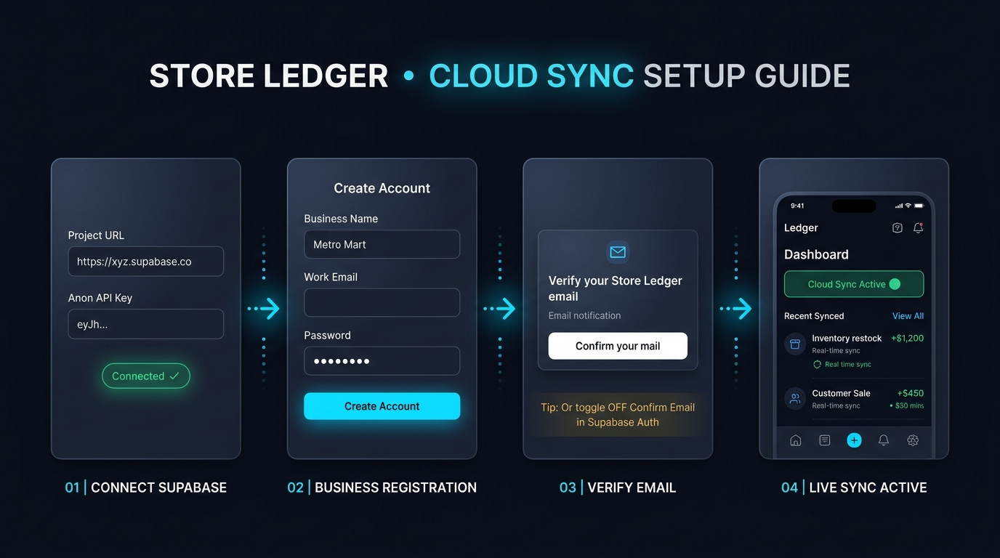
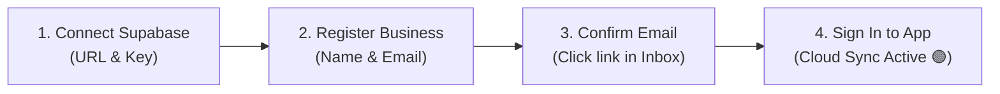

# Store Ledger • Cloud Sync Activation Guide

---

## Why Is Business Registration & Login Required?

Store Ledger is built with an **Offline-First, Multi-Tenant Architecture**:

1. **Complete Offline Privacy**: Without cloud connection, all your customer ledgers and transactions reside 100% on your local device.
2. **Row Level Security (RLS) Isolation**: When connecting Supabase, the database enforces strict multi-tenant Row Level Security (`auth.uid() = user_id`).
3. **Your Business Owns Its Data**: Entering your Project URL and Publishable Key establishes the cloud pipe, but your **business account session (`auth.uid()`) is the cryptographic key** that protects and isolates your store's transactions.

---

## Step-by-Step Activation Walkthrough

### Step 1: Connect Your Supabase Project
- In Store Ledger, open **Settings → Connect Your Supabase** (or launch from the setup wizard).
- Enter your **Supabase Project URL** (`https://<project-ref>.supabase.co`) and **Publishable Key** (or legacy anon public key).
- Tap **Test Connection**, then tap **Connect & Save**.
- The status pill will display:
  > **Connected • Login Needed for Sync** (Amber Badge)

---

### Step 2: Register Your Business Account
- In Store Ledger, open **Settings → Cloud Sync / Sign In** (or tap the yellow **"Sign In / Register Business Account"** banner).
- Toggle mode to **"Register"** or **"New Business"**.
- Fill in:
  - **Business Name** (e.g., *Metro Mart*, *Haji Traders*)
  - **Email Address** (your store email)
  - **Password** (at least 6 characters)
- Tap **Register Business Account**.

---

### Step 3: Confirm Your Email Link

> [!IMPORTANT]
> By default, Supabase creates new accounts with email verification enabled (`email_confirmed_at = null`). Until you click the confirmation link, Supabase will reject login attempts with **"Email not confirmed"**.

1. Open your email app (Gmail, Outlook, Yahoo, etc.).
2. Look for an email from **Supabase** with subject *"Confirm your signup"* or *"Verify your Store Ledger email"*.
   *(Check your **Spam / Junk folder** if it does not appear in your inbox within 1 minute).*
3. Tap the **"Confirm your mail"** or verification button.

> [!TIP]
> ### ⚡ Pro-Tip: Skip Email Confirmation for Instant Login
> If you want immediate access without having to check your email inbox:
> 1. Open your **Supabase Dashboard** (`https://supabase.com/dashboard/project/<your-project-id>`).
> 2. In the left navigation, click **Authentication** → **Providers**.
> 3. Click **Email**.
> 4. Toggle **OFF** the switch labeled **"Confirm email"**.
> 5. Click **Save** at the bottom.
> 
> *Once turned off, you can register any business account and log in immediately without waiting for an email!*

---

### Step 4: Sign In & Cloud Sync Active! 🟢

1. Return to Store Ledger and enter your business **Email** and **Password** under **Sign In**.
2. Tap **Sign In**.
3. The app status pill immediately turns green:
   > **Cloud Sync Active (your_email@example.com)** 🟢
4. All existing local transactions and offline edits immediately sync to your private cloud database, and any changes on other devices will update in real time!

---

## Status Indicators in Store Ledger

| Status Badge | Meaning | Action Needed |
|:---|:---|:---|
| **Offline Mode (Not Connected)** | App is running 100% locally on device | None. Fully functional offline. Connect Supabase in Settings if cloud backup is desired. |
| **Connected • Login Needed for Sync** | Supabase database is connected, but no user session exists | Tap banner → Register or Sign in with your business account. |
| **Cloud Sync Active (user@store.com)** | Database connected & authenticated | Real-time multi-device cloud synchronization is active and healthy. |

---

## Troubleshooting Common Errors

### "Email not confirmed"
- **Cause**: You attempted to sign in before clicking the confirmation link sent to your email.
- **Fix**: Check your email inbox (and Spam folder) for the verification email, click the link, and try signing in again. Alternatively, disable **"Confirm email"** in Supabase Dashboard → Authentication → Providers → Email.

### "User already registered"
- **Cause**: An account with this email already exists in your Supabase project.
- **Fix**: Switch the tab from *Register* to *Sign In* at the top of the screen and enter your password.

### "Invalid login credentials"
- **Cause**: Incorrect email or password.
- **Fix**: Verify your password. You can also reset it or inspect users in **Supabase Dashboard → Authentication → Users**.
