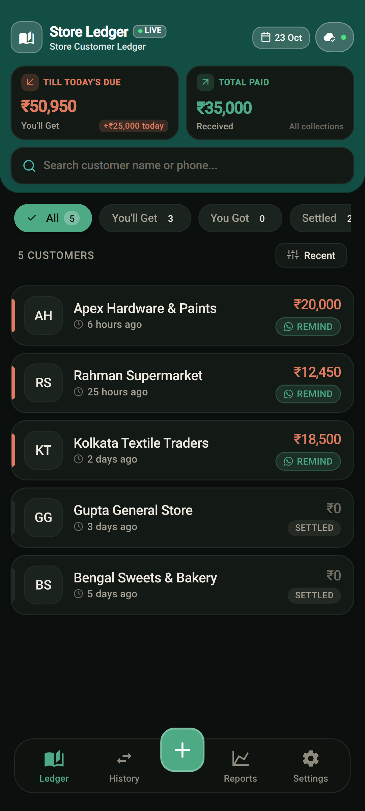
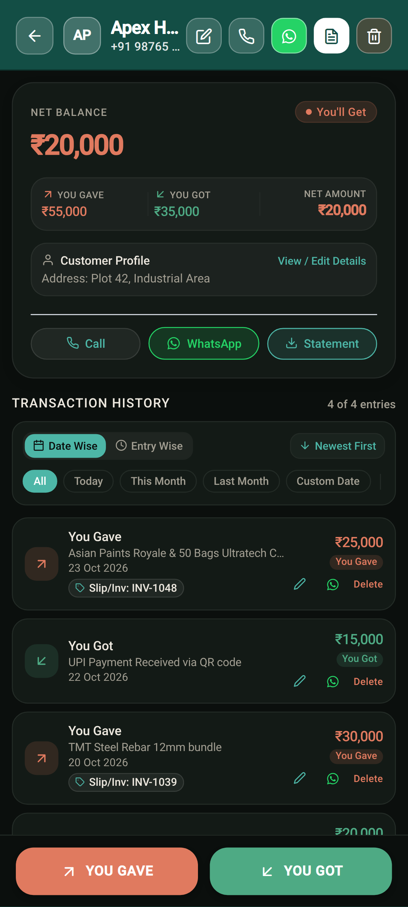
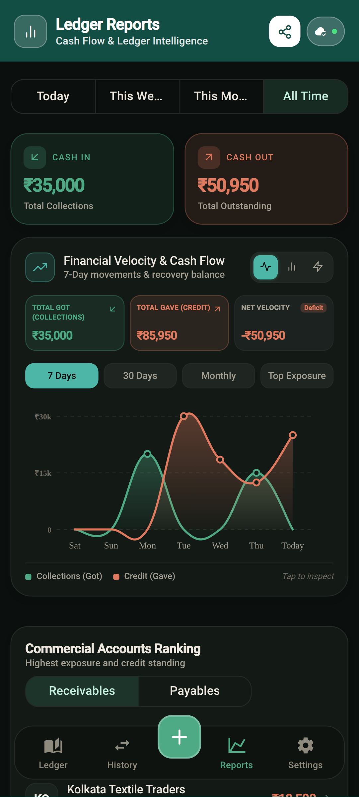

<div align="center">

  

  # Store Ledger • Modern Business Customer Ledger & Cash Book

  <p><b>100% Offline-First Digital Customer Khata with Zero Ads, Zero Vendor Lock-in & Optional Supabase Cloud Sync</b></p>

  [](https://www.storeledger.in/)
  [](https://github.com/iamrony27/storeledger/releases/tag/v2.0.0)
  [](./LICENSE)
  [](https://docs.expo.dev/)
  [](https://www.typescriptlang.org/)
  [](https://www.storeledger.in/)
  [-00BCD4?style=for-the-badge&logo=virustotal&logoColor=white)](https://www.virustotal.com/gui/file/5735227a8d3e7ce2f589ded3abf78ae7a1d93afbdea897ac5127df9f01661f9e)

  <br />

  <a href="https://rookieenough.github.io/Orion-Data/redirect.html?id=storeledger">
    
  </a>
  &nbsp;&nbsp;
  <a href="https://github.com/iamrony27/storeledger/releases/download/v2.0.0/StoreLedger-v2.0.0.apk">
    
  </a>

  <br /><br />

  [🌐 Official Website](https://www.storeledger.in/) • [🛡️ VirusTotal Report](https://www.virustotal.com/gui/file/5735227a8d3e7ce2f589ded3abf78ae7a1d93afbdea897ac5127df9f01661f9e) • [🔒 Privacy Policy](https://www.storeledger.in/privacy.html) • [📜 Terms of Service](https://www.storeledger.in/terms.html) • [🚀 Cloud Sync Guide](./CLOUD_SYNC_ACTIVATION_GUIDE.md)

</div>

---

## 📱 In-App Screenshots

<div align="center">
  <table>
    <thead>
      <tr>
        <th align="center"><b>Executive Dashboard &amp; Ledger</b></th>
        <th align="center"><b>Customer Statement &amp; Khata</b></th>
        <th align="center"><b>Cash Flow Velocity &amp; Analytics</b></th>
      </tr>
    </thead>
    <tbody>
      <tr>
        <td align="center">
          
        </td>
        <td align="center">
          
        </td>
        <td align="center">
          
        </td>
      </tr>
      <tr>
        <td align="center"><sub>Real-time balances, filter pills &amp; quick entry FAB</sub></td>
        <td align="center"><sub>KPI balance breakdown &amp; split tactile entry buttons</sub></td>
        <td align="center"><sub>Smooth Bézier velocity curves &amp; debtor exposure</sub></td>
      </tr>
    </tbody>
  </table>
</div>

---

## ⚖️ Head-to-Head Comparison

How **Store Ledger** stands against proprietary closed-source ledger applications:

| Feature / Capability | <div align="center"><br /><b>Store Ledger</b><br /><sub>(v2.0.0 Open Source)</sub></div> | <div align="center"><br /><b>Khatabook</b><br /><sub>(Proprietary)</sub></div> | <div align="center"><br /><b>OkCredit</b><br /><sub>(Proprietary)</sub></div> |
| :--- | :---: | :---: | :---: |
| **100% Offline Operation** | ✅ **Yes** (Zero lag, no internet required) | ❌ Requires active internet | ❌ Requires active internet |
| **Data Ownership & Cloud** | ✅ **You Own It** (BYO Supabase PostgreSQL) | ❌ Locked on Khatabook servers | ❌ Locked on OkCredit servers |
| **Advertisements & Loans** | ✅ **100% Ad-Free** (Zero loan promotions) | ❌ In-app loan & credit card ads | ❌ Financial marketing push |
| **Mandatory Phone / OTP** | ✅ **No OTP Required** (Instant startup) | ❌ Mandatory mobile OTP login | ❌ Mandatory mobile OTP login |
| **Multi-Currency Support** | ✅ **9 Global Currencies** (INR, USD, EUR, etc.) | ❌ Primarily INR only | ❌ Primarily INR only |
| **Fractional Decimal Toggle** | ✅ **Yes** (`.00` precision switchable) | ❌ Whole numbers only | ❌ Whole numbers only |
| **Integer Math Engine** | ✅ **Strict Minor Units** (Zero rounding drift) | ⚠️ Standard floating point | ⚠️ Standard floating point |
| **Cryptographic Backups** | ✅ **SHA-256 Verified** JSON snapshots | ❌ Proprietary cloud lock-in | ❌ Proprietary cloud lock-in |
| **License & Code Audit** | ✅ **MIT Open Source** (Auditable on GitHub) | ❌ Closed Source | ❌ Closed Source |

---

## 🌟 Key Highlights

### ⚡ 1. 100% Offline-First Architecture
- **Instant Speed:** Never wait for remote spinners or network timeouts. All customer accounts, daily transactions, and balance totals compute on-device using local SQLite storage.
- **Integer Precision Math:** Stored and calculated internally in minor units (e.g. paise/cents) to eliminate IEEE-754 floating-point drift.
- **Privacy Guaranteed:** Financial data remains exclusively on your hardware unless you choose to connect your private cloud.

### 🌍 2. Multi-Currency & Decimal Precision Control
- **9 Global Currencies:** Native formatting for **INR (₹)**, **USD ($)**, **EUR (€)**, **GBP (£)**, **BDT (৳)**, **AED (AED)**, **SAR (SAR)**, **CAD (CA$)**, and **AUD (A$)**.
- **Decimal Amounts Toggle (`.00`):** Seamlessly switch between exact decimal amounts (e.g. `₹1,250.50`) and clean rounded figures (e.g. `₹1,251`).
- **Big Number Autoscaling:** Amounts in Lakhs, Crores, and Millions gracefully scale down (`adjustsFontSizeToFit`) across headers, transaction rows, and balance cards without clipping.

### ☁️ 3. Bring Your Own Supabase (Zero Vendor Lock-In)
- **Direct Database Ownership:** Connect directly to your personal Supabase project using your Project URL and Publishable Key.
- **Zero Intermediary Servers:** Store Ledger maintains no centralized servers. Mobile clients communicate directly with your private PostgreSQL database over TLS 1.3.
- **Row Level Security (RLS):** Strict PostgreSQL policies ensure only authenticated owners can access their tenant data.
- **Activation Walkthrough:** Step-by-step setup guide with visual infographic in [CLOUD_SYNC_ACTIVATION_GUIDE.md](./CLOUD_SYNC_ACTIVATION_GUIDE.md).

### 📊 4. Cash Flow Velocity & Visual Intelligence
- **Smooth Bézier Splines:** Fluid cash flow curves displaying Collections (Got) vs Credit (Gave) across 7-day, 30-day, and 12-month intervals.
- **Non-Colliding Adaptive Y-Axis:** Clean metric intervals (`0`, `₹500`, `₹1k`, `₹2.5k`, `₹10k`) that adapt to your sales volume.
- **Exposure Ranking:** Identifies top receivable accounts for proactive debt collection.

### 📄 5. Receipts, Reminders & Statements
- **PDF Export:** Generates clean, branded HTML-to-PDF customer statements and audit summaries.
- **Instant WhatsApp Reminders:** Pre-formatted payment reminder messages in English and Bengali (বাংলা) with last payment details.
- **Digital Payment Slips:** One-tap shareable receipts via native Android share sheets.

### 🔐 6. Cryptographic Backups
- **SHA-256 Checksums:** Backup snapshots validated with FIPS 180-4 cryptographic hashing.
- **UUID Idempotency:** Duplicate-proof restores guarantee no duplicate transactions are ever created.

---

## 🛠️ Technology Stack

| Layer | Technologies |
| :--- | :--- |
| **Framework** | [React Native](https://reactnative.dev/) (Expo SDK 57) |
| **Language** | [TypeScript 5.9](https://www.typescriptlang.org/) (Strict Mode) |
| **Local Storage** | SQLite / Expo SQLite (Offline-First) |
| **Cloud Sync** | [Supabase](https://supabase.com/) (PostgreSQL with Row Level Security) |
| **Design System** | Google Material Design 3 (Expressive Tonal Palette) |
| **Testing** | Jest 29, 16 automated test suites (100% passing) |

---

## 🚀 Getting Started

### Prerequisites
- [Node.js](https://nodejs.org/) (v20.x, v22.x, or v24.x)
- [Expo CLI](https://docs.expo.dev/)
- Android device with **Expo Go** or an Android Emulator

### Installation & Run
```bash
# 1. Clone the repository
git clone https://github.com/iamrony27/storeledger.git
cd storeledger

# 2. Install dependencies
npm install

# 3. Start local development server
npx expo start
```

### Verification & Automated Tests
```bash
# Run all automated unit and integration tests
npm test

# Run strict TypeScript type checks
npx tsc --noEmit

# Diagnose Expo dependencies and project configuration
npx expo-doctor
```

---

## 📦 Production Builds & Verification

| Parameter | Specification |
| :--- | :--- |
| **Package Name** | `com.gwd.book` |
| **Version** | `2.0.0` (Build Code: `12`) |
| **Target Architecture** | `arm64-v8a`, `armeabi-v7a`, `x86`, `x86_64` |
| **Android Compatibility** | Android 8.0 (Oreo / API 26) through Android 15 (API 35) |
| **SHA-256 Checksum** | `5735227a8d3e7ce2f589ded3abf78ae7a1d93afbdea897ac5127df9f01661f9e` |
| **Security Audit** | [VirusTotal Scan Report (0/68 Clean)](https://www.virustotal.com/gui/file/5735227a8d3e7ce2f589ded3abf78ae7a1d93afbdea897ac5127df9f01661f9e) • 100% Malware-Free |
| **Official APK Release** | [StoreLedger-v2.0.0.apk](https://github.com/iamrony27/storeledger/releases/tag/v2.0.0) |

---

## 📄 Privacy & Licensing

- **License:** Distributed under the permissive [MIT License](./LICENSE). Free for commercial and personal use.
- **Privacy Policy:** Read our complete [Privacy Policy](https://www.storeledger.in/privacy.html).
- **Terms of Service:** Review the [Terms of Service](https://www.storeledger.in/terms.html).

---

<div align="center">
  <sub>Built with ❤️ for independent business owners & shopkeepers worldwide.</sub>
</div>
